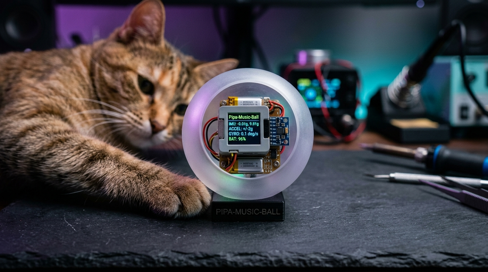
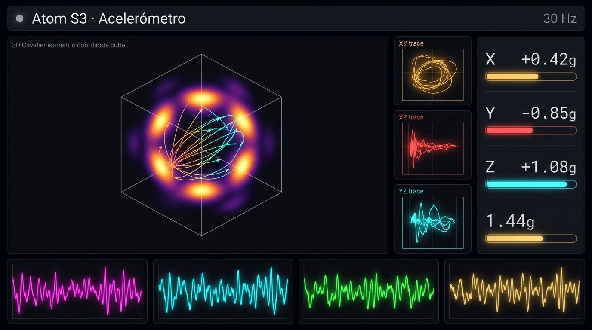

# Pipa-Music-Ball — Bio-Kinetic Interactive Instrument & Telemetry

[](LICENSE)
[](https://docs.m5stack.com/en/core/AtomS3)
[](https://docs.m5stack.com/en/core/AtomS3)
[]()
[]()

> An embedded bio-kinetic physical computing instrument housed inside an interactive rolling sphere. Powered by an **M5Stack Atom S3** (ESP32-S3 microcontroller with a 6-DoF MPU6886 accelerometer and gyroscope), it translates physical feline play vectors into microtonal acoustics and real-time 3D telemetry visualizations.

---

## 🐾 The Physical Instrument



*The Pipa-Music-Ball prototype: translucent frosted sphere housing the M5Stack Atom S3 color LCD core, 6-DoF inertial sensor, and power system, designed for feline interaction and kinetic telemetry translation.*

---

## ⚡ Real-Time 3D Telemetry Dashboard



*Real-time browser-based telemetry visualizer (`visualizer.html`) displaying 3D Cavalier trajectory projections, orthogonal heatmaps (XY, XZ, YZ), live metric readouts, and 4-channel scrolling acceleration oscilloscopes.*

---

## 🌟 Key Features

- **Embedded Sensor Fusion (M5Stack Atom S3 & MPU6886)**:
  - Low-latency 30Hz register polling of 6-DoF acceleration ($a_x, a_y, a_z$) and angular velocity via MicroPython.
  - On-device color LCD diagnostics reporting connection status, packet throughput, and instantaneous vector magnitude.
- **Asynchronous Telemetry Streamer (`atom_s3_accel_udp.py`)**:
  - Encodes raw motion vectors into packed binary UDP datagrams (`<ffff` struct: X, Y, Z, and total Magnitude) broadcast over Wi-Fi.
- **Zero-Latency WebSocket Broker (`udp_ws_bridge.py`)**:
  - Python asyncio daemon bridging high-frequency UDP packets to modern browser WebSockets with sub-10ms latency.
- **3D Cavalier Isometric Space & Orthogonal Slices**:
  - Custom canvas rendering engine plotting the continuous motion path within a 3D bounding volume.
  - Three synchronized orthogonal projection views: **XY (superior, amber)**, **XZ (front, red)**, and **YZ (lateral, cyan)** with persistent kinetic heatmap decay.
- **Microtonal Web Audio Sonification Engine**:
  - Synthesizes microtonal harmonic scales modulated by rotational jerk and kinetic momentum, turning feline play into an evolving acoustic performance.
- **4-Channel High-Speed Oscilloscopes**:
  - Live waveform visualization tracking $a_x$, $a_y$, $a_z$, and Euclidean magnitude $||a|| = \sqrt{a_x^2 + a_y^2 + a_z^2}$.

---

## 📐 Architecture & Data Flow

```
┌────────────────────────────────────────┐
│     Physical Sphere Motion (Play)      │
└───────────────────┬────────────────────┘
                    │ Kinetic forces
                    ▼
┌────────────────────────────────────────┐
│      MPU6886 6-DoF Inertial Sensor     │
└───────────────────┬────────────────────┘
                    │ I2C Bus @ 30Hz
                    ▼
┌────────────────────────────────────────┐
│   ESP32-S3 Core (atom_s3_accel_udp.py) │
└───────────────────┬────────────────────┘
                    │ Binary UDP datagrams (<ffff)
                    ▼
┌────────────────────────────────────────┐
│    Host Bridge (udp_ws_bridge.py)      │
└─────────┬────────────────────┬─────────┘
          │ WebSocket          │ WebSocket
          ▼                    ▼
┌──────────────────┐  ┌──────────────────┐
│  3D Visualizer   │  │ Web Audio Synth  │
│  (Cavalier &     │  │ (Microtonal      │
│   Oscilloscopes) │  │  Sonification)   │
└──────────────────┘  └──────────────────┘
```

---

## 📁 Repository Structure

```
pipa-music-ball/
├── gallery/
│   ├── sphere_prototype.jpg        # Physical prototype hardware photograph
│   └── telemetry_dashboard.jpg     # 3D Cavalier visualizer & oscilloscope suite
├── atom_s3_accel_udp.py            # MicroPython firmware for M5Stack Atom S3
├── udp_ws_bridge.py                # Python asyncio UDP-to-WebSocket bridge
├── visualizer.html                 # Complete real-time browser visualizer & audio synth
├── osc_receiver_test.py            # Standalone diagnostics test listener
├── secrets.py.example              # Wi-Fi credential template
├── .gitignore
└── README.md
```

---

## 🚀 Quick Start Guide

### 1. Configure & Flash Hardware
1. Copy `secrets.py.example` to `secrets.py` on your M5Stack Atom S3:
   ```python
   WIFI_SSID = "YOUR_WIFI_NETWORK"
   WIFI_PASS = "YOUR_WIFI_PASSWORD"
   TARGET_IP = "192.168.1.100"  # IP of host machine running bridge
   TARGET_PORT = 5005
   ```
2. Upload `atom_s3_accel_udp.py` to the device using [Thonny](https://thonny.org/) or `ampy`.
3. Power the device; the display will show connection progress and confirm active 30Hz streaming.

### 2. Launch Host Bridge & Visualizer
1. Start the bridge on the host computer:
   ```bash
   python3 udp_ws_bridge.py
   ```
2. Open `visualizer.html` in Chrome, Firefox, or Safari.
3. As the ball rolls or is batted, watch the 3D Cavalier space trace the acceleration vector while the synthesizer responds with microtonal acoustic feedback.

---

## 🛠️ Hardware Bill of Materials (BOM)

| Component | Specification | Function |
|---|---|---|
| **Microcontroller Core** | [M5Stack Atom S3](https://docs.m5stack.com/en/core/AtomS3) (ESP32-S3) | 240MHz dual-core, 0.85" color LCD, Wi-Fi |
| **Inertial Measurement Unit** | MPU6886 | 6-DoF 3-axis accelerometer ($\pm 2g$) & 3-axis gyro |
| **Power Supply** | 3.7V LiPo 150mAh battery + step-up regulator | Autonomous wireless operation inside sphere |
| **Enclosure** | 70mm Frosted Translucent Acrylic Sphere | Rolling bio-kinetic housing for feline interaction |

---

## 👤 Author & Research Context

Developed by **Carlos Romero Madrid** ([@carrommad](https://github.com/carrommad))  
*Computational Physicist & Scientific Software Engineer*  
Barcelona Supercomputing Center (BSC-CNS)

Part of an exploration into **physical computing, bio-kinetic interaction, and creative scientific sonification** alongside [MNusic (HPC Synthesizer)](https://github.com/carrommad/mnusic) and [Expo-Curator](https://github.com/carrommad/expo-curator).

Licensed under the [MIT License](LICENSE).
